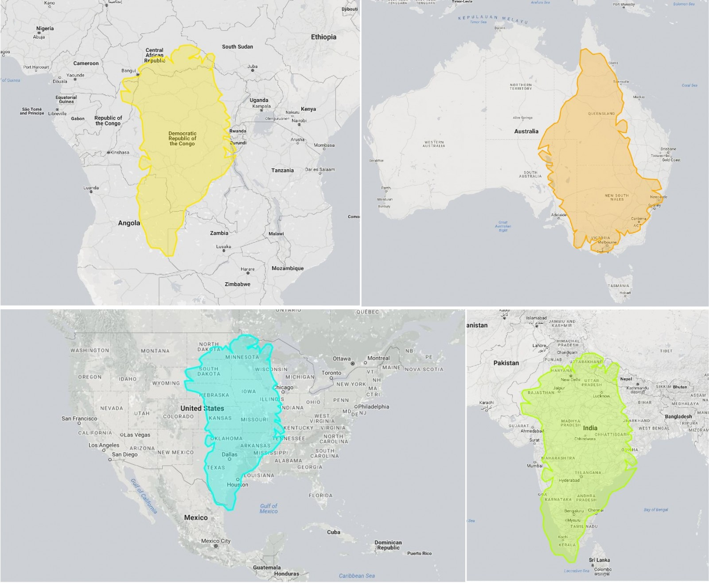

## Today's session {.smaller}

| | | |
|---|---|---|
| **Block 1** | Concepts & Theory — *this deck* | ~35 min |
| **Block 2** | Guided demo: load geometry → reproject → join → choropleth | ~35 min |
| ☕ | Break | ~15 min |
| **Block 3** | Hands-on: your rate-based choropleth, defensibly classified | ~50 min |
| **Block 4** | Wrap-up & homework preview | ~15 min |

::: {.gw-box}
**Today's claim:** a map is the most *trusted-looking* chart there is — which is exactly why the foundations (projections, normalization, classification) matter more here than anywhere.
:::

# The Earth is not flat {background-color="#2E6E8E"}

## The true size of Greenland {.smaller}

Greenland's real outline, laid over four places at true scale:

{fig-align="center" width="33%"}

::: {style="font-size:0.58em; text-align:center; color:#666"}
Image: [The true size of Greenland](https://blogs.egu.eu/divisions/cr/2017/10/06/image-of-the-week-the-true-size-of-greenland/),
EGU Cryospheric Sciences Blog, 2017.
:::

## Why Greenland looks wrong {.smaller}

On a Web Mercator map Greenland appears about the size of Africa. It is not —
it is roughly the size of the Democratic Republic of the Congo, which is one
country within Africa.

Greenland sits at a high latitude, and Mercator stretches everything away from
the equator. **The further from the equator, the bigger the exaggeration.**

That is not a flaw in the projection. Mercator was built so that a straight
line on the chart is a constant compass bearing, which is exactly what you want
for navigating a ship. It buys that by sacrificing area. The mistake is not
using Mercator; it is using it to compare how big things are.

## Two states, the same size {.smaller}

Florida and Michigan have the same land area — they differ by **0.3%**. Here
they are drawn twice from the same file — Florida in blue, Michigan in red —
changing nothing but the projection.

```{python}
#| echo: false
#| fig-align: center
import warnings
warnings.filterwarnings("ignore")
import geopandas as gpd
import matplotlib.pyplot as plt
from shapely.affinity import translate

_states = gpd.read_file("../dats6401/weekly/week9/data/states.geojson")
_pair = _states[_states["state"].isin(["Florida", "Michigan"])]

fig, axes = plt.subplots(1, 2, figsize=(10, 3.6))
for ax, (epsg, label) in zip(axes, [
        (5070, "Equal-area (EPSG:5070)"),
        (3857, "Web Mercator (EPSG:3857)")]):
    p = _pair.to_crs(epsg=epsg)
    areas, shifted = {}, []
    for i, (_, row) in enumerate(p.iterrows()):
        areas[row["state"]] = row.geometry.area
        c = row.geometry.centroid
        shifted.append((row["state"],
                        translate(row.geometry, xoff=i * 9e5 - c.x, yoff=-c.y)))
    for color, (name, geom) in zip(["#2E6E8E", "#d9534f"], shifted):
        gpd.GeoSeries([geom], crs=p.crs).plot(ax=ax, color=color,
                                              edgecolor="white", linewidth=0.5)
    ax.set_title(label, fontsize=11)
    ax.set_aspect("equal"); ax.axis("off")
    ratio = areas["Michigan"] / areas["Florida"]
    ax.text(0.5, -0.02, f"Michigan is {ratio:.2f}x Florida",
            transform=ax.transAxes, ha="center", fontsize=12,
            color="#2E6E8E" if epsg == 5070 else "#d9534f")
plt.tight_layout(); plt.show()
```

Same data, same code, one setting changed. Web Mercator stretches everything
away from the equator, so the northern state gains half its size again. Nothing
warns you.

## How much does the stretch amount to? {.smaller}

The distortion is not a quirk at the poles. It is already large inside the
lower 48:

```{python}
#| echo: false
import pandas as pd

_c = _states[~_states["state"].isin(
    ["Alaska", "Hawaii", "Puerto Rico", "District of Columbia"])].copy()
_eq = _c.to_crs(epsg=5070)
_mc = _c.to_crs(epsg=3857)
_c["inflation"] = (_mc.geometry.area.values / _eq.geometry.area.values)
_c["inflation"] /= _c["inflation"].min()           # relative to the southernmost
_c["latitude"] = _eq.geometry.centroid.to_crs(epsg=4326).y.values

_show = _c.set_index("state").loc[
    ["Florida", "Texas", "Missouri", "Michigan", "North Dakota"],
    ["latitude", "inflation"]].round(2)
_show.columns = ["center latitude", "area inflated by"]
print(_show.to_string())
print(f"\nnorthernmost vs southernmost: {_c.inflation.max():.2f}x")
```

A state at the Canadian border takes up **1.7 times** the area it should,
relative to one on the Gulf. On a choropleth, visual weight is area — so Web
Mercator silently gives northern regions more of the reader's attention.

## Every projection lies about something

Flattening a sphere **must** distort. Each projection chooses what to preserve:

| Projection family | Preserves | Sacrifices |
|---|---|---|
| Conformal (Mercator) | local shapes/angles | **area** (Greenland ≈ Africa?!) |
| Equal-area (Albers, Mollweide) | area | shapes |
| Equidistant | distances from a point | most else |

::: {.gw-box}
**Rule:** comparing *how much* across regions (a choropleth)? Use an **equal-area** projection — otherwise the projection itself biases the visual weight of every region.
:::

## CRS: the coordinate contract

A **Coordinate Reference System** says what the numbers mean:

- `EPSG:4326` — raw longitude and latitude in degrees, as a GPS reports them.
  Fine for storing and exchanging data, and **not a flat map**: degrees are not
  a length, so any area or distance you compute in it is wrong.
- `EPSG:3857` — Web Mercator, what almost every web tile map uses. Fine for
  navigating, wrong for comparing sizes, as the last few slides showed.
- `EPSG:5070` — Albers equal-area conic, the usual choice for analyzing the
  contiguous United States.

## Codes come from registries {.smaller}

`EPSG` is a registry of coordinate systems, each with a number. It is the main
one, but not the only one — Esri maintains its own, and you will meet those
codes in the wild:

```{python}
#| echo: false
from pyproj import CRS

for _code in ["EPSG:5070", "ESRI:102003"]:
    _c = CRS.from_user_input(_code)
    print(f"{_code:12} {_c.name}")
    print(f"{'':12} datum: {_c.datum.name}")

# Both of these are built for the CONTIGUOUS states, so only those are used --
# projecting Alaska with a lower-48 projection would distort it badly.
_lower48 = _states[~_states["state"].isin(["Alaska", "Hawaii", "Puerto Rico"])]
_a = _lower48.to_crs("EPSG:5070").geometry.area.sum()
_b = _lower48.to_crs("ESRI:102003").geometry.area.sum()
print(f"\ntotal land area of the lower 48 plus DC:")
print(f"  EPSG:5070   {_a/1e6:>12,.0f} km2")
print(f"  ESRI:102003 {_b/1e6:>12,.0f} km2")
print(f"  difference  {abs(_a-_b)/_a*100:>12.4f} %")
```

**They are the same projection.** Same Albers equal-area conic, same NAD83
datum, areas identical to four decimal places. The difference is which
organization issued the number, not what the map looks like. Note the
`ESRI:` prefix — `to_crs("ESRI:102003")` works, `to_crs(102003)` does not,
because a bare number is assumed to be EPSG.

## The commonest geospatial bug {.smaller}

Combining two layers that are in different coordinate systems. They will not
line up, and often nothing raises an error — a spatial join simply matches
nothing, and you get an empty result that looks like a data problem.

In geopandas: check `gdf.crs`, convert with `gdf.to_crs(...)`, and do it
**before** any join, any area, any distance.

# The choropleth, done honestly {background-color="#2E6E8E"}

## A shapefile is not a file {.smaller}

The oldest and still the commonest format. It is not one file — it is a set of
them that must travel together, and the Census boundaries this week came as
exactly that:

| extension | holds | size here |
|---|---|---|
| `.shp` | the geometry | 811 KB |
| `.dbf` | the attribute table | 10 KB |
| `.shx` | an index into the `.shp` | 1 KB |
| `.prj` | **the coordinate system** | under 1 KB |
| `.xml` | metadata | 15 KB |

Email a colleague the `.shp` on its own and they get nothing usable. Lose the
`.prj` — the smallest file in the set — and nobody can tell what the
coordinates mean any more. Ours says `EPSG:4269`.

## What else a shapefile will do to you {.smaller}

Three limits worth knowing before they surprise you, all from a format designed
in the early 1990s around the dBASE table:

- **Field names are capped at 10 characters.** Anything longer is silently
  truncated, and two columns that collide after truncation are a real problem.
  Our file's longest column is `CENSUSAREA` — exactly ten. That is not a
  coincidence; it has already been shortened.
- **2 GB per file.** Reachable with detailed national data.
- **No real text encoding guarantee.** Non-English place names come back
  mangled often enough that it is a known genre of bug.

None of this means avoid shapefiles — most public data still ships as one. It
means check the field names and the `.prj` before you trust anything.

## GeoJSON, and the newer options {.smaller}

**GeoJSON** is a single text file, which is why this course uses it:

```{python}
#| echo: false
import os
_gj = "../dats6401/weekly/week9/data/states.geojson"
print(f"states.geojson, one file: {os.path.getsize(_gj)/1024:,.0f} KB")
print(f"  features: {len(_states)}")
print(f"  CRS      : {_states.crs}  (GeoJSON is always lon/lat WGS84)")
print()
print("the same boundaries, unsimplified:")
print("  as a shapefile set   :   848 KB   (binary, five files)")
print("  as GeoJSON           : 1,634 KB   (text, one file)")
```

It is roughly twice the size, because text always loses to binary. In exchange
it is one file, readable in any editor, diffable in git, and sendable in a
message. **Its coordinate system is fixed**: the spec says longitude and
latitude on WGS84, so a GeoJSON carries no projection choice at all.

Two more you will meet:

- **TopoJSON** stores each shared border once rather than twice. For
  administrative boundaries, where every internal edge belongs to two polygons,
  that is a large saving.
- **GeoPackage** (`.gpkg`) is a single SQLite file holding layers, attributes
  and the coordinate system together. It is the modern answer to the
  shapefile's five-file problem, and geopandas reads it happily.

## Where to get boundaries {.smaller}

- [**US Census mapping files**](https://www.census.gov/geographies/mapping-files.html)
  — the authoritative source for states, counties, tracts and block groups.
  Pick a resolution: 20m, 5m and 500k mean the generalization level, and the
  coarsest is usually right for a national choropleth.
- [**US boundaries as GeoJSON**](https://eric.clst.org/tech/usgeojson/)
  — the same Census boundaries already converted, if you would rather skip the
  shapefile step.
- [**geojson.io**](https://geojson.io/) — paste or drag a file in and see it on
  a map immediately. Also lets you draw a shape by hand and export it, which is
  the quickest way to make a test polygon.

**Use geojson.io as a check.** Before debugging a map that renders empty, drop
the file there. If it shows nothing, the problem is the file, not your code.

## A boundary file is almost empty {.smaller}

Before any of this, a question worth asking out loud: what is actually *in* the
file we have been drawing?

```{python}
#| echo: false
print("columns in states.geojson:")
for _col in _states.columns:
    print("   ", _col)
print()
print(_states[["fips", "state", "land_sqmi"]].head(3).to_string(index=False))
```

A name, a code, a land area, and a shape. That is the whole file. Nothing in it
can tell you anything about the people who live there, what the air is like, or
how anyone voted.

**Every interesting map on this slide deck is a join.** The geometry supplies
the where; something else has to supply the what.

## Where the numbers come from {.smaller}

The numbers we have been mapping are from the **American Community Survey**,
run by the US Census Bureau. It is not the decennial census — it is a rolling
survey of about 3.5 million addresses a year, which is how the country gets
detailed statistics between censuses.

It is published two ways, and the choice matters:

| | covers | currency | precision |
|---|---|---|---|
| **1-year estimates** | areas of 65,000 people or more | most recent | noisier |
| **5-year estimates** | every area, down to block groups | 60 months pooled | steadier |

Our file is the **5-year** version, which is why Vermont and Wyoming are in it
at all. A 1-year file would simply not have the small places.

## Estimates, not counts {.smaller}

This is the part people skip. ACS figures are **survey estimates**, not head
counts, and the Census Bureau publishes a margin of error with every one of
them.

At state level those margins are small and you can mostly ignore them. At
census tract level they are often large enough that two tracts with visibly
different colors on your map are **not actually distinguishable**.

Our export does not carry the margins — they are a separate set of columns you
can ask for. Before mapping anything below county level, go and get them, and
decide whether the difference you are about to color in is real.

## Social Explorer {.smaller}

Pulling that data straight from the Census Bureau means learning their table
naming, their geography codes and their download tools.
[**Social Explorer**](https://www.socialexplorer.com/) is a front end that
takes most of that away: pick a survey, pick the tables, pick the geography,
and it hands back a CSV plus a codebook explaining every column.

The file behind this week's maps came from exactly that — report
`R50111025`, ACS 2024 5-year estimates, at state level.

::: {.gw-box}
**Live demo now.** Pulling a table by hand, start to finish.
:::

GWU has a subscription, so sign in through the library rather than paying.

## What else is worth joining {.smaller}

The same trick works with anything that carries a geographic code:

- **People:** the ACS, for income, age, language, housing, commuting
- **Health:** the CDC publishes small-area estimates of chronic conditions
  and health behaviors
- **Environment:** the EPA for air quality and pollution sources, NOAA for
  weather and climate
- **Economy:** the Bureau of Labor Statistics for employment by county

What makes the join possible is the **FIPS code** — a numeric identifier the
Census Bureau assigns to every state, county and tract, which nearly every US
public dataset carries. `01` is Alabama in our file and `01` is Alabama in all
of these. That shared key is the quiet reason any of this works.

**The caution:** two datasets can share a FIPS code and still not be
comparable. Different years, different definitions, different survey
populations. The join will succeed and the map will look fine. Check what you
are actually putting side by side.

## Counts lie; rates compare

Both maps below show the same column of the same table: the number of people
aged 65 and over in each state, from the 2024 American Community Survey. The
left one maps the **count**. The right one maps the **share** — that count
divided by the state's population.

```{python}
#| echo: false
#| fig-align: center
import geopandas as gpd
import pandas as pd
import numpy as np
import matplotlib.pyplot as plt

DATA = "../dats6401/weekly/week9/data"
states = gpd.read_file(f"{DATA}/states.geojson")
stats = pd.read_csv(f"{DATA}/state_stats.csv", dtype={"fips": str})
us = states.merge(stats, on="fips", suffixes=("_geo", ""))
conus = us[~us["state"].isin(["Alaska", "Hawaii", "Puerto Rico"])]

fig, axes = plt.subplots(1, 2, figsize=(11, 4))
conus.plot(column="pop_65plus", cmap="OrRd", legend=True, ax=axes[0],
           edgecolor="white", linewidth=0.4)
axes[0].set_title("Count: people aged 65+")
conus.plot(column="pct_65plus", cmap="OrRd", legend=True, ax=axes[1],
           edgecolor="white", linewidth=0.4)
axes[1].set_title("Share: % of the state aged 65+")
for a in axes: a.axis("off")
plt.tight_layout(); plt.show()
```

## The same state, two very different answers {.smaller}

```{python}
#| echo: false
ca = conus[conus["state"] == "California"].iloc[0]
n = len(conus)
print(f"California, {int(ca.pop_65plus):,} people aged 65+ ({ca.pct_65plus}% of the state)")
print(f"  rank by count : {int((conus.pop_65plus > ca.pop_65plus).sum()) + 1} of {n}")
print(f"  rank by share : {int((conus.pct_65plus > ca.pct_65plus).sum()) + 1} of {n}")
print()
print("darkest three by count:", ", ".join(conus.nlargest(3, "pop_65plus")["state"]))
print("darkest three by share:", ", ".join(conus.nlargest(3, "pct_65plus")["state"]))
```

California is **first** by count and **44th of 49** by share. The left-hand map
is not really showing you where older people live — it is showing you where
*people* live, because a big state has more of everything.

A count map is usually a **population map wearing a different label**. Map the
rate — per person, per square mile, per 1,000 — unless the count itself is what
you are asking about. A count is the right thing to map when you need to know
how many ambulances to send; a rate is the right thing when you are asking
whether a place is unusual.

## A choropleth's other bias: size {.smaller}

Even in an equal-area projection, a choropleth gives every region as much ink
as it has land. That is rarely what you want to compare.

```{python}
#| echo: false
_eqc = conus.to_crs(epsg=5070)
_a = conus.copy()
_a["area"] = _eqc.geometry.area.values
_a["area_share"] = 100 * _a["area"] / _a["area"].sum()
_a["pop_share"] = 100 * _a["pop_total"] / _a["pop_total"].sum()

_big = _a.nlargest(10, "area")
_small = _a.nsmallest(10, "area")
print(f"the 10 largest states by land area: "
      f"{_big.area_share.sum():.0f}% of the map, {_big.pop_share.sum():.0f}% of the people")
print(f"the 10 smallest states by land area: "
      f"{_small.area_share.sum():.0f}% of the map, {_small.pop_share.sum():.0f}% of the people")
print()
for _s in ["Montana", "Wyoming", "New Jersey"]:
    _r = _a[_a["state"] == _s].iloc[0]
    print(f"  {_s:<12} {_r.area_share:4.1f}% of the map, {_r.pop_share:4.1f}% of the people")
```

Montana is about **fifteen times** more of the picture than it is of the population.
New Jersey is the reverse. Nobody chose that; it is a consequence of using land
as the canvas.

## When a choropleth is the wrong tool {.smaller}

A choropleth can only show a **rate over an area**. For a raw count, or for
anything that happens at a point, it is the wrong shape of map. The usual
alternative is a **proportional symbol map**: one mark per place, with the
**area of the mark** carrying the number.

```{python}
#| echo: false
#| fig-align: center
import matplotlib.pyplot as plt

_p = conus.copy()
_p = _p.set_geometry(_p.to_crs(epsg=5070).geometry)
_cent = _p.geometry.centroid

fig, axes = plt.subplots(1, 2, figsize=(12, 4))
_p.plot(column="pop_total", cmap="OrRd", ax=axes[0], edgecolor="white",
        linewidth=0.4)
axes[0].set_title("Choropleth of a count", fontsize=11)
_p.plot(ax=axes[1], color="#EAF2F6", edgecolor="#99b3bb", linewidth=0.4)
axes[1].scatter(_cent.x, _cent.y, s=_p["pop_total"] / 40000, alpha=0.65,
                color="#d9534f", edgecolors="white", linewidth=0.6)
axes[1].set_title("Proportional symbols", fontsize=11)
for a in axes: a.axis("off")
plt.tight_layout(); plt.show()
```

Look at the north-east. In the choropleth New Jersey, Massachusetts and
Connecticut are almost invisible, because they are small. In the symbol map
they are among the larger circles, because a circle's size does not depend on
how much land the state happens to own.

## Classification: how you bin is what they see

**Classification** means deciding which values share a color. A map with five
shades has to cut the numbers into five groups, and where you put the cuts is a
choice you make, not something the data decides.

```{python}
#| echo: false
#| fig-align: center
fig, axes = plt.subplots(1, 3, figsize=(14, 3.8))
for ax, scheme, label in [(axes[0], "quantiles", "Quantiles"),
                          (axes[1], "equal_interval", "Equal interval"),
                          (axes[2], "natural_breaks", "Natural breaks (Jenks)")]:
    conus.plot(column="pct_65plus", scheme=scheme, k=5, cmap="OrRd", legend=True,
               ax=ax, edgecolor="white", linewidth=0.4,
               legend_kwds={"fontsize": 6, "loc": "lower left"})
    ax.set_title(f"{label}, 5 classes", fontsize=10); ax.axis("off")
plt.suptitle("The same share-of-65+ numbers, cut three different ways")
plt.tight_layout(); plt.show()
```

## What each one is doing {.smaller}

**Quantiles** puts the same number of states in every class. Every color gets
used and the map always looks like it has a spread, even when the underlying
numbers barely differ. It is counting states, not looking at their values.

**Equal interval** cuts the value range into equal-width slices. It is looking
only at the highest and lowest number; everything in between is ignored. If the
states are bunched with one outlier far off, nearly all of them land in one
class and the map goes flat.

**Natural breaks**, usually called **Jenks** after the cartographer George
Jenks, is the only one of the three that reads the actual values. It searches
for the set of cuts that makes each class as internally similar as possible —
so the boundaries end up in the **gaps**, where the data is already separating
itself.

## Why Jenks puts its cuts somewhere else {.smaller}

Every state on one axis, and where each scheme decides to cut:

```{python}
#| echo: false
#| fig-align: center
import mapclassify

_v = np.sort(conus["pct_65plus"].values)
_k = 5
_cuts = {
    "Quantiles": list(pd.Series(_v).quantile([i / _k for i in range(1, _k)])),
    "Equal interval": [_v.min() + (_v.max() - _v.min()) * i / _k for i in range(1, _k)],
    "Natural breaks": list(mapclassify.NaturalBreaks(_v, k=_k).bins[:-1]),
}

fig, axes = plt.subplots(3, 1, figsize=(12, 3.9), sharex=True)
for ax, (name, cuts) in zip(axes, _cuts.items()):
    ax.scatter(_v, np.zeros_like(_v), s=40, color="#2E6E8E", alpha=0.75,
               zorder=3, clip_on=False)
    for x in cuts:
        ax.axvline(x, color="#d9534f", lw=2, zorder=2)
    ax.set_yticks([]); ax.set_ylim(-0.5, 0.5)
    ax.set_ylabel(name, rotation=0, ha="right", va="center", fontsize=9)
    for sp in ("top", "right", "left"):
        ax.spines[sp].set_visible(False)
axes[-1].set_xlabel("share of the state aged 65+  (%)")
plt.tight_layout(); plt.show()
```

Each dot is a state. **Quantiles** pushes all four cuts into the crowded middle,
because that is where equal counts of states fall — the thinly populated ends
get no boundary at all. **Equal interval** spaces its cuts evenly and pays no
attention to where the states actually are. **Jenks** puts its cuts in the
visible gaps.

## So which one? {.smaller}

- **Jenks** when you want the groups the data already suggests. It is the usual
  default in mapping software for a reason.
- **Quantiles** when you want to compare rank — the top fifth against the
  bottom fifth — or when you need every class to contain something.
- **Equal interval** when the numbers have meaning on their own, like
  percentages or temperature, and a reader would expect even steps.

Jenks has one real catch: because the cuts come from the data, **two maps made
with Jenks are not comparable**. Map this year and last year separately and the
class boundaries move, so the same color means two different things. For a
before-and-after pair, fix the breaks by hand and say so.

Nothing here is dishonest. The dishonest move is not choosing — it is not
**disclosing**. Put the scheme in the caption.

## How many classes? {.smaller}

The scheme is one choice; the **number of classes** is another, and it changes
the map just as much.

```{python}
#| echo: false
#| fig-align: center
fig, axes = plt.subplots(1, 3, figsize=(14, 3.6))
for ax, k in zip(axes, [3, 5, 8]):
    conus.plot(column="pct_65plus", scheme="quantiles", k=k, cmap="OrRd",
               legend=True, ax=ax, edgecolor="white", linewidth=0.4,
               legend_kwds={"fontsize": 6, "loc": "lower left"})
    ax.set_title(f"{k} classes", fontsize=11); ax.axis("off")
plt.tight_layout(); plt.show()
```

Three classes is a blunt instrument that hides real variation. Eight is more
colors than most people can tell apart, especially from the back of a room.
**Four to seven** is the usual advice, and the reason is the reader's eye, not
the data.

## Sequential color, and the gray problem {.smaller}

- Rates/intensities → **sequential** palette (light→dark, one hue)
- Diverging only when a meaningful midpoint exists (± change)
- Missing data → **gray, labeled** — never silently the lightest class

::: {.gw-box}
Week 2's effectiveness rule, geographically: color *lightness* is doing the quantitative work on a choropleth — that's why we classify into 5–7 bins the eye can actually distinguish.
:::

# The toolchain {background-color="#2E6E8E"}

## The Python geospatial stack (Block 2's pipeline)

```python
import geopandas as gpd
gdf = gpd.read_file("regions.geojson")     # geometry + attributes
gdf = gdf.to_crs(epsg=5070)                # equal-area BEFORE analysis

joined = gdf.merge(data, on="region_id")   # attach your data
joined["rate"] = joined["cases"] / joined["pop"] * 100_000

joined.plot(column="rate", scheme="quantiles", k=5,
            cmap="OrRd", legend=True)       # mapclassify under the hood
```

*(Static here — geopandas needs real geometry files; Block 2 runs this live on US data.)*

Spatial **joins** (`gpd.sjoin`) attach points to polygons — "which district is each incident in" — the geometric cousin of `merge`.

## Discussion {.gw-discussion}

**1.** A viral map shows COVID cases by county, raw counts, Web Mercator, equal-interval bins. List every fix — in priority order.

**2.** When is a *count* map the honest choice?

## Coming up next — Block 2 {.smaller}

Live demo, six parts:

1. Load the boundaries and check the coordinate system
2. Join the statistics; a count against a rate
3. Classification: how the color cuts change the map
4. Projections: the same states three ways
5. The spatial join — matching by location instead of by key
6. `.explore()` — the same map, interactive

**Then Block 3**, on your own after class: the same pipeline on a column you
choose, plus `app_map_starter.py`, a Streamlit map whose controls are the
choices this deck has been arguing about.

**Readings:** geopandas user guide · the EPSG registry at epsg.io · Brewer,
*Designing Better Maps*

**Homework:** a choropleth of a rate, with a caption that names the source, the
denominator, the classification scheme, the projection, and anything you left
off the map.
