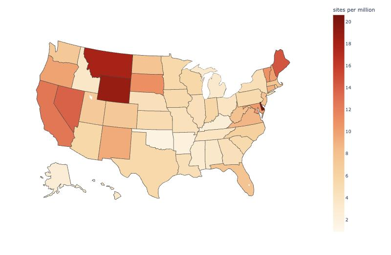
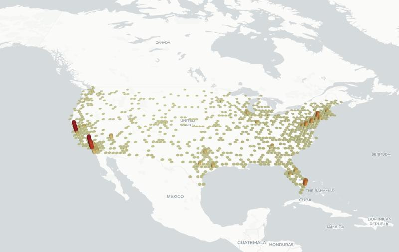

## Today's session {.smaller}

| | | |
|---|---|---|
| **Block 1** | Concepts & Theory — *this deck* | ~35 min |
| **Block 2** | Guided demo, run live | ~35 min |
| ☕ | Break | ~15 min |
| **Block 3** | Hands-on, on your own afterwards | ~50 min |
| **Block 4** | Wrap-up & homework preview | ~15 min |

::: {.gw-box}
**Today's idea:** Week 9 built maps you look at. This week builds maps you can
**ask questions of** — and gets the data into the right shape to answer them,
which usually means a spatial operation rather than a chart option.
:::

Running example: **2,264 Tesla Supercharger sites** in the United States, with
coordinates, stall counts and opening dates.

# Maps you can interrogate {background-color="#00223e"}

## What interaction is actually for {.smaller}

Week 9 ended with one interactive map and left it there. The question it did
not answer is what interaction buys, because "it feels modern" is not a reason.

Three things a printed map genuinely cannot do:

- **Hover.** Put the number next to the color, so nobody has to measure a shade
  against a legend. Reading color is the thing people are worst at, and this
  removes the need.
- **Zoom.** Every reader has a personal location and will look for it. A
  national map at national zoom cannot also be a city map.
- **Select.** Click or hover one thing and have the rest of the display
  respond. This is the one that changes what questions are askable.

**What it does not buy is honesty.** The classification, the projection and
whatever you left off the map are still choices, and an interactive map that
hides them is a dishonest map you can zoom.

## Four tools, four jobs {.smaller}

| | wraps | reach for it when |
|---|---|---|
| **folium** | Leaflet | you want a normal web map: tiles, markers, popups |
| **plotly** | plotly.js | you want hover and a built-in US layout, fast |
| **altair** | Vega-Lite | one view should drive another |
| **pydeck** | deck.gl | many points, or height as an encoding |

They all read roughly the same data and all produce HTML. The choice is about
what you want the reader to be able to *do*, not about which draws prettier
circles.

All four fetch their JavaScript from a CDN, so the maps need internet to
display even when your analysis is entirely offline.

# From points to regions {background-color="#00223e"}

## The data is points; the question is about states {.smaller}

```{python}
#| echo: false
import warnings
warnings.filterwarnings("ignore")
import numpy as np
import pandas as pd
import geopandas as gpd
import matplotlib.pyplot as plt

DATA = "../dats6401/weekly/week10/data"
sites = pd.read_csv(f"{DATA}/superchargers_us.csv")
print(f"{len(sites)} sites, {sites.stalls.sum():,} stalls")
print(sites.head(3)[["name", "state", "lat", "lon", "stalls"]].to_string(index=False))
```

We want a choropleth of sites per state. The file has a `state` column, so we
could group on it and be done.

**Do not.** That column is an attribute someone typed. The question "which
state is this point in" is a *geometric* one, and answering it geometrically is
the operation worth learning — because most of the time there is no such
column.

## Point in polygon {.smaller}

```python
points = gpd.GeoDataFrame(sites, crs="EPSG:4326",
                          geometry=gpd.points_from_xy(sites.lon, sites.lat))
tagged = gpd.sjoin(points, states, predicate="within", how="left")
```

A **spatial join** matches rows by geometry instead of by a key. `within` asks
which polygon contains each point. Other predicates answer other questions:
`intersects` for any overlap, `contains` for the other direction, `touches` for
shared edges only.

Use **`how="left"`**. The default silently drops every point that matched
nothing — which is the set you most need to see.

```{python}
#| echo: false
states = gpd.read_file(f"{DATA}/states.geojson")[["fips", "state", "geometry"]]
states = states.rename(columns={"state": "state_polygon"})
points = gpd.GeoDataFrame(sites, crs="EPSG:4326",
                          geometry=gpd.points_from_xy(sites.lon, sites.lat))
tagged = gpd.sjoin(points, states, predicate="within", how="left")
print(f"{len(points)} points in, {tagged.fips.notna().sum()} matched a state, "
      f"{tagged.fips.isna().sum()} matched nothing")
```

## The three that matched nothing {.smaller}

```{python}
#| echo: false
print(tagged[tagged.fips.isna()][["name", "state", "lat", "lon"]].to_string(index=False))
```

```{python}
#| echo: false
#| fig-align: center
missed = tagged[tagged.fips.isna()]
fig, axes = plt.subplots(1, 3, figsize=(11.5, 2.6))
for ax, (_, r) in zip(axes, missed.iterrows()):
    states.plot(ax=ax, color="#ebf0f2", edgecolor="#033c5a", linewidth=1.1)
    ax.scatter([r.lon], [r.lat], s=95, color="#d9534f", zorder=5,
               edgecolor="white", linewidth=1.2)
    ax.set_xlim(r.lon - 0.18, r.lon + 0.18); ax.set_ylim(r.lat - 0.18, r.lat + 0.18)
    ax.set_title(r["name"][:28], fontsize=9)
    ax.set_xticks([]); ax.set_yticks([])
plt.tight_layout(); plt.show()
```

**None of these is in the sea.** Each sits in the hairline gap where the
simplified outline has pulled away from the real one — the Hudson shoreline,
the Nevada–Oregon border, the Texas coast.

They fell out because the boundary file is **simplified** — the coastlines are
smoothed inland and the barrier islands rounded off, to keep it at 344 KB.

Week 9 said generalized boundaries are fine for coloring regions and wrong for
measuring them. Add a third: they are wrong for **joining**, and the join does
not raise anything. With `how="inner"` these three would simply never have
existed.

## Now the choropleth {.smaller}

```{python}
#| echo: false
#| fig-align: center
acs = pd.read_csv(f"{DATA}/state_stats.csv", dtype={"fips": str})
per_state = (tagged.dropna(subset=["fips"])
             .groupby(["fips", "state_polygon"])
             .agg(sites=("name", "size"), stalls=("stalls", "sum"))
             .reset_index()
             .merge(acs[["fips", "pop_total"]], on="fips"))
per_state["per_million"] = (1e6 * per_state.sites / per_state.pop_total).round(1)

shapes = gpd.read_file(f"{DATA}/states.geojson")
m = shapes.merge(per_state, on="fips")
conus_m = m[~m.state.isin(["Alaska", "Hawaii", "Puerto Rico"])]

fig, axes = plt.subplots(1, 2, figsize=(12.5, 3.8))
conus_m.plot(column="sites", cmap="OrRd", legend=True, ax=axes[0],
             edgecolor="white", linewidth=0.4)
axes[0].set_title("sites per state", fontsize=10)
conus_m.plot(column="stalls", cmap="OrRd", legend=True, ax=axes[1],
             edgecolor="white", linewidth=0.4)
axes[1].set_title("stalls per state", fontsize=10)
for a in axes: a.axis("off")
plt.tight_layout(); plt.show()
```

Two different counts of the same network. **Stalls** is the better measure of
capacity — a site with 40 stalls is not one site's worth of charging — and the
two maps are not identical.

## And the rate, again {.smaller}

```{python}
#| echo: false
#| fig-align: center
fig, axes = plt.subplots(1, 2, figsize=(12.5, 3.6))
conus_m.plot(column="sites", cmap="OrRd", legend=True, ax=axes[0],
             edgecolor="white", linewidth=0.4)
axes[0].set_title("count: sites per state", fontsize=10)
conus_m.plot(column="per_million", cmap="OrRd", legend=True, ax=axes[1],
             edgecolor="white", linewidth=0.4)
axes[1].set_title("rate: sites per million people", fontsize=10)
for a in axes: a.axis("off")
plt.tight_layout(); plt.show()

print("most sites:", ", ".join(per_state.nlargest(3, "sites").state_polygon))
print("most per million:", ", ".join(per_state.nlargest(3, "per_million").state_polygon))
```

Week 9's lesson arrived at from the other side. California has by far the most
and is twelfth per person; Delaware, Wyoming and Montana lead per capita on
about twenty sites each.

Getting here took **two joins of two different kinds**: points to polygons by
location, then polygons to population by key.

# The layout problem {background-color="#00223e"}

## Where Alaska actually is {.smaller}

```{python}
#| echo: false
#| fig-align: center
fig, axes = plt.subplots(1, 2, figsize=(13, 3.3))
shapes.plot(ax=axes[0], color="#ebf0f2", edgecolor="#033c5a", linewidth=0.4)
axes[0].set_title("all 52, at their real coordinates", fontsize=10)
shapes[~shapes.state.isin(["Alaska", "Hawaii", "Puerto Rico"])].plot(
    ax=axes[1], color="#ebf0f2", edgecolor="#033c5a", linewidth=0.4)
axes[1].set_title("the lower 48 and DC", fontsize=10)
for a in axes:
    a.set_xticks([]); a.set_yticks([]); a.set_aspect(1.3)
plt.tight_layout(); plt.show()

b = shapes.total_bounds
ak = shapes[shapes.state == "Alaska"].geometry.iloc[0]
print(f"all 52 span {b[2] - b[0]:.1f} degrees of longitude, because Alaska is "
      f"{len(list(ak.geoms))} polygons and {sum(1 for p in ak.geoms if p.bounds[0] > 0)} "
      f"of them sit past +180")
```

The Aleutians cross the **antimeridian**, the line where longitude flips from
+180 to −180. Ask for the extent of the United States and you get nearly the
whole planet.

## Albers USA: the map that lies on purpose {.smaller}

The standard fix is a **composite projection**. Albers USA projects the lower
48 normally, then shrinks Alaska, moves it, moves Hawaii, and parks both in the
empty space below California.

The result is **deliberately wrong about where two states are**, and nobody
objects, because the honest version is unreadable.

{fig-align="center" width="62%"}

```python
px.choropleth(df, locations="abbr", locationmode="USA-states", scope="usa")
alt.Chart(gdf).mark_geoshape().project(type="albersUsa")
```

Worth saying out loud: this is a convention that survives because it is useful,
not because it is true, and most readers have never noticed it. It is also not
an Alaska problem — it is a **dateline** problem, and it will meet you again in
Fiji, Kiribati, Russia, or any shipping route across the Pacific.

# Altair: one view drives another {background-color="#00223e"}

## Selections {.smaller}

folium and plotly give you hover and zoom. Altair's distinctive idea is the
**selection**: you declare that interacting with one mark changes what the
other marks draw, and Vega-Lite wires it up. No callback, no redraw.

```python
pick = alt.selection_point(fields=["state"], on="mouseover", empty=False)

dots = base_dots.encode(
    opacity=alt.condition(pick, alt.value(0.9), alt.value(0.08))
).add_params(pick)
```

Two details that cost people an hour:

- `add_params` goes on the layer you **interact with**; `alt.condition` goes on
  every layer that should **respond**
- `empty=False`. The default is `True`, which means "nothing selected"
  highlights everything — so the chart looks broken only when the pointer is
  off it

## What it is for {.smaller}

The pattern generalizes to anything with a **from** and a **to**: flight routes
between airports, shipments between ports, migrations between counties,
citations between papers.

In the demo we use it on the nearest-neighbor pairs — each site joined to the
one closest to it — so hovering a state lights up its local network and dims
the rest.

Altair embeds the data inside the chart specification, which is why the charts
are self-contained and also why a large GeoDataFrame makes a large notebook.
Ours is about 530 KB. Simplify the geometry if that becomes a problem.

# Distance {background-color="#00223e"}

## Degrees are not a distance {.smaller}

Week 9 made this point about area. It returns here and it is sharper, because
distance is the whole subject.

```{python}
#| echo: false
for lat in (26, 38, 48, 61):
    print(f"at {lat}N, one degree of longitude = {111.32 * np.cos(np.radians(lat)):6.1f} km")
print("\nat every latitude, one degree of latitude = ~111.0 km")
```

```{python}
#| echo: false
#| fig-align: center
fig, axes = plt.subplots(1, 3, figsize=(11, 2.9))
for ax, (la, col) in zip(axes, [(26, "#033c5a"), (42, "#e6a23c"), (58, "#d9534f")]):
    th = np.linspace(0, 2 * np.pi, 300)
    ax.plot((50 / (111.32 * np.cos(np.radians(la)))) * np.cos(th),
            (50 / 111.32) * np.sin(th), color=col, lw=2.2)
    ax.axhline(0, color="#ddd", lw=.6); ax.axvline(0, color="#ddd", lw=.6)
    ax.set_aspect("equal"); ax.set_xlim(-1, 1); ax.set_ylim(-1, 1)
    ax.set_title(f"{la}N — {2*50/(111.32*np.cos(np.radians(la))):.2f}° wide, 0.90° tall",
                 fontsize=9, color=col)
    ax.tick_params(labelsize=6)
plt.suptitle("the same 50 km circle, drawn on a latitude/longitude grid", fontsize=10)
plt.tight_layout(); plt.show()
```

A degree of latitude is a fixed distance. A degree of longitude shrinks toward
the poles. So `sqrt(dlat**2 + dlon**2)` — the formula everyone reaches for
first — measures in a unit that changes as you move north.

## Haversine {.smaller}

The **haversine** formula gives the distance between two points across the
surface of a sphere. It is built into the libraries you already have:

```python
from sklearn.neighbors import BallTree

tree = BallTree(np.radians(coords), metric="haversine")   # radians, not degrees
distances, indices = tree.query(np.radians(coords), k=2)  # k=2: itself, then the nearest
km = distances[:, 1] * 6371.0088                          # Earth's radius
```

Two details that return wrong answers in silence:

- it wants **radians**, and will accept degrees and give you nonsense
- the result is an **angle**, so multiply by the Earth's radius

## How far is the nearest one? {.smaller}

A choropleth of chargers-per-state tells you nothing about the drive.

```{python}
#| echo: false
#| fig-align: center
from sklearn.neighbors import BallTree

EARTH_KM = 6371.0088
conus = sites[(sites.lat.between(24, 50)) & (sites.lon.between(-125, -66))].copy()
tree = BallTree(np.radians(conus[["lat", "lon"]].values), metric="haversine")
dist, idx = tree.query(np.radians(conus[["lat", "lon"]].values), k=2)
conus["nearest_km"] = dist[:, 1] * EARTH_KM

fig, ax = plt.subplots(figsize=(9, 2.7))
ax.hist(conus.nearest_km, bins=60, color="#033c5a")
ax.set_xlabel("km to the nearest other Supercharger"); ax.set_ylabel("sites")
plt.tight_layout(); plt.show()
print(f"median {conus.nearest_km.median():.1f} km | mean {conus.nearest_km.mean():.1f} km "
      f"| 90th percentile {conus.nearest_km.quantile(.9):.1f} km")
```

The mean is more than twice the median — that is the long right tail showing up
as a number. **Report the median.**

## Both ends of that column {.smaller}

```{python}
#| echo: false
print("farthest from anything:")
print(conus.nlargest(4, "nearest_km")[["name", "state", "nearest_km"]].round(0).to_string(index=False))
print("\nclosest together:")
print(conus.nsmallest(4, "nearest_km")[["name", "state", "nearest_km"]].round(3).to_string(index=False))
```

One end is coverage: Hines, Oregon is 168 km from its nearest neighbor, and no
choropleth of Oregon would have shown that.

The other end is **not geography at all**. Thirty-six metres apart, and the
names give it away: `Baker, CA` and `Baker (Expansion), CA`. The same place
entered twice. A query written to answer a coverage question has found a data
quality problem that every map so far hid, because at national zoom the two
dots are one dot.

# Finding groups {background-color="#00223e"}

## DBSCAN {.smaller}

Points that sit in dense bunches get grouped; everything else is labeled
**noise**. Unlike k-means it is not told how many groups to find, and it is not
required to place every point.

Two parameters:

- **`eps`** — how far apart still counts as "close"
- **`min_samples`** — how many neighbors within `eps` a point needs before it
  can anchor a group

```{python}
#| echo: false
#| fig-align: center
from sklearn.cluster import DBSCAN as _DB
rng = np.random.default_rng(3)
demo = np.vstack([rng.normal([0, 0], .45, (40, 2)),
                  rng.normal([3, 1], .35, (30, 2)),
                  rng.uniform(-2, 5, (18, 2))])
fig, axes = plt.subplots(1, 3, figsize=(11.5, 2.9))
for ax, eps in zip(axes, [0.35, 0.6, 1.2]):
    lab = _DB(eps=eps, min_samples=5).fit_predict(demo)
    for v in sorted(set(lab)):
        m = lab == v
        ax.scatter(demo[m, 0], demo[m, 1], s=16,
                   color="#cccccc" if v == -1 else None)
    ax.set_title(f"eps={eps}  →  {len(set(lab)) - (1 if -1 in lab else 0)} groups, "
                 f"{(lab == -1).sum()} noise", fontsize=9)
    ax.set_xticks([]); ax.set_yticks([]); ax.set_aspect("equal")
plt.suptitle("same 88 points, three values of eps (grey = noise)", fontsize=10)
plt.tight_layout(); plt.show()
```

Both are yours to choose, and the answer moves when they do. A defensible
choice sounds like "50 km is roughly a short detour for a driver", not "it
looked good".

## The mistake that makes it wrong {.smaller}

The obvious call is `DBSCAN(eps=0.45)` on a table of latitude and longitude,
with `eps` worked out as 50 km over 111 km per degree.

It runs. It returns clusters. It is wrong for the reason two sections back:
that `eps` means 50 km north-south and something else east-west.

```{python}
#| echo: false
from sklearn.cluster import DBSCAN
from sklearn.metrics import adjusted_rand_score

EPS_KM, MIN_SAMPLES = 50, 5
coords = conus[["lat", "lon"]].values
right = DBSCAN(eps=EPS_KM / EARTH_KM, min_samples=MIN_SAMPLES,
               metric="haversine").fit_predict(np.radians(coords))
wrong = DBSCAN(eps=EPS_KM / 111.0, min_samples=MIN_SAMPLES).fit_predict(coords)
conus["cluster"] = right
for nm, lab in [("haversine on radians", right), ("euclidean on degrees", wrong)]:
    print(f"{nm:22} {len(set(lab)) - (1 if -1 in lab else 0):3} clusters, "
          f"{(lab == -1).sum():4} points left as noise")
```

## How much does it cost? {.smaller}

Cluster numbers are arbitrary, so comparing "cluster 7" across runs means
nothing. Two things survive relabeling:

```{python}
#| echo: false
print(f"adjusted Rand index: {adjusted_rand_score(right, wrong):.3f}"
      "   (1.0 would be the same grouping)")
flipped = (right == -1) != (wrong == -1)
print(f"\npoints whose noise status differs: {flipped.sum()} of {len(conus)}")
print(f"  clustered by haversine, called noise by euclidean: "
      f"{((right != -1) & (wrong == -1)).sum()}")
print(f"  the reverse:                                       "
      f"{((right == -1) & (wrong != -1)).sum()}")
print()
for lo, hi, nm in [(24, 34, "south of 34N"), (34, 42, "34 to 42N"), (42, 50, "north of 42N")]:
    band = conus.lat.between(lo, hi).values
    print(f"  {nm:14} {band.sum():4} sites, differs for {flipped[band].mean():5.1%}")
```

```{python}
#| echo: false
#| fig-align: center
fig, axes = plt.subplots(1, 2, figsize=(11.5, 2.9))
for ax, lab, nm in [(axes[0], right, "haversine"), (axes[1], wrong, "euclidean on degrees")]:
    ax.scatter(conus.lon[lab == -1], conus.lat[lab == -1], s=7, color="#dddddd")
    ax.scatter(conus.lon[lab != -1], conus.lat[lab != -1], s=9,
               c=lab[lab != -1], cmap="tab20")
    ax.set_title(f"{nm}: {len(set(lab)) - 1} clusters, {(lab == -1).sum()} noise",
                 fontsize=10)
    ax.set_aspect(1.3); ax.set_xticks([]); ax.set_yticks([])
plt.tight_layout(); plt.show()

```

Two maps of the same 2,254 points, differing only in the distance metric.

## The error grows with latitude {.smaller}

```{python}
#| echo: false
#| fig-align: center
fig, ax = plt.subplots(figsize=(7.5, 2.4))
bands = [(24, 34, "south of 34N"), (34, 42, "34–42N"), (42, 50, "north of 42N")]
vals = [100 * flipped[conus.lat.between(lo, hi).values].mean() for lo, hi, _ in bands]
ax.barh([b[2] for b in bands], vals, color="#d9534f")
for i, v in enumerate(vals):
    ax.text(v + 0.12, i, f"{v:.1f}%", va="center", fontsize=10)
ax.set_xlabel("share of sites whose noise status changes"); ax.set_xlim(0, 9)
for s in ("top", "right"): ax.spines[s].set_visible(False)
plt.tight_layout(); plt.show()
```

**Every disagreement runs the same way** — haversine finds a cluster, Euclidean
calls it noise, never the reverse — and the error roughly doubles from the Gulf
to the Canadian border.

Nothing raises an exception. The northern states simply end up with fewer
clusters than they should.

## Reading the result {.smaller}

```{python}
#| echo: false
big = (conus[conus.cluster != -1].groupby("cluster")
       .agg(sites=("name", "size"), stalls=("stalls", "sum"),
            lat=("lat", "mean"), lon=("lon", "mean"))
       .sort_values("sites", ascending=False))
print(f"{len(big)} clusters, {(conus.cluster == -1).sum()} points as noise. The six largest:")
print(big.head(6).round(1).to_string())
```

## Check the groups are real {.smaller}

DBSCAN got coordinates and nothing else — no city names, no boundaries, no
population. The labels below were added **after** the clustering, by reading
each centroid and recognizing the place:

```{python}
#| echo: false
#| fig-align: center
fig, ax = plt.subplots(figsize=(9.5, 3.2))
ax.scatter(conus.lon, conus.lat, s=5, color="#dddddd")
names = {0: "New York / N. New Jersey", 10: "Los Angeles",
         5: "Bay Area", 4: "central Florida"}
for cid, nm in names.items():
    g = conus[conus.cluster == cid]
    ax.scatter(g.lon, g.lat, s=14, color="#d9534f")
    ax.annotate(f"{nm}\n{len(g)} sites", (g.lon.mean(), g.lat.mean()),
                xytext=(10, 10), textcoords="offset points", fontsize=8,
                arrowprops=dict(arrowstyle="-", color="#999999", lw=.8))
ax.set_aspect(1.3); ax.set_xticks([]); ax.set_yticks([])
ax.set_title("the four largest clusters, labeled after the fact", fontsize=9)
plt.tight_layout(); plt.show()
```

It recovered the metropolitan areas from the dots alone. **Run this check
before believing any clustering** — the algorithm returns groups whether or not
there are any.

## Noise is not failure {.smaller}

```{python}
#| echo: false
#| fig-align: center
fig, ax = plt.subplots(figsize=(10, 4.3))
noise = conus[conus.cluster == -1]
ax.scatter(noise.lon, noise.lat, s=11, color="#bbbbbb", label=f"noise ({len(noise)})")
for cid in big.head(8).index:
    g = conus[conus.cluster == cid]
    ax.scatter(g.lon, g.lat, s=20, label=f"{cid} ({len(g)})")
ax.set_aspect(1.3); ax.set_xticks([]); ax.set_yticks([])
ax.legend(fontsize=7, loc="lower left", ncol=3)
ax.set_title(f"haversine, eps={EPS_KM} km, min_samples={MIN_SAMPLES}")
plt.tight_layout(); plt.show()
```

For a charging network the grey points may be the **most** interesting
category: the lone stations on long highways, built so a gap is covered rather
than because demand was dense.

# Density surfaces {background-color="#00223e"}

## The heat map {.smaller}

A heat map smooths the points into a continuous surface.
`folium.plugins.HeatMap` takes a list of coordinates and does the rest:

```python
from folium.plugins import HeatMap
HeatMap(sites[["lat", "lon"]].values, radius=12).add_to(m)
```

```{python}
#| echo: false
#| fig-align: center
fig, axes = plt.subplots(1, 3, figsize=(14, 3.3))
for ax, g in zip(axes, [20, 60, 150]):
    ax.hexbin(conus.lon, conus.lat, gridsize=g, cmap="inferno", mincnt=1)
    ax.set_title(f"gridsize = {g}", fontsize=10)
    ax.set_aspect(1.3); ax.set_xticks([]); ax.set_yticks([])
plt.suptitle("the same 2,254 points, three resolutions")
plt.tight_layout(); plt.show()
```

**The radius is the claim.** A large one says "the coasts", a small one says
"individual cities", and both are the same points. Put the setting in the
caption, exactly as Week 9 put the class breaks there.

A density surface also invents a value **between** the observations, where
nothing was measured. That is usually what you want, and it is worth knowing
you asked for it.

# The third dimension {background-color="#00223e"}

## Height as an encoding {.smaller}

`pydeck` wraps **deck.gl**, the library Streamlit uses for `st.pydeck_chart`.
Its `HexagonLayer` bins points into hexagons and then **extrudes** them, so
height carries the count:

{fig-align="center" width="58%"}

Our 2,254 sites. The tall columns are the Bay Area, Los Angeles, the Northeast
corridor and south Florida.

## What the parameters do {.smaller}

```python
pdk.Layer("HexagonLayer", data=sites,
          get_position=["lon", "lat"],
          radius=35000,            # hexagon size in METRES -- the binning choice
          elevation_scale=250,     # how tall a count of 1 becomes
          elevation_range=[0, 1000],
          extruded=True,
          pickable=True)           # hover for the bin's contents

pdk.ViewState(latitude=39, longitude=-98, zoom=3.4,
              pitch=50,            # camera tilt; 0 is straight down
              bearing=0)           # rotation
```

- **`radius`** is the same decision as the heat map's radius and the hexbin's
  gridsize, now in metres. It decides what counts as one place.
- **`elevation_scale`** is a free parameter with no units anyone can read. It
  makes the bars taller. It does not make the counts bigger.
- **`pitch`** is the whole difference between a map and a 3D scene. At 0 you
  have a flat hexbin.

## The pattern worth copying {.smaller}

Streamlit's own NYC ridesharing demo is the clearest example of using this
well. Its shape:

1. load once, cached, and **filter** on a control — an hour-of-day slider
2. the filtered frame feeds the `HexagonLayer`, so moving the slider rebuilds
   the 3D map
3. the **same layer** is drawn four times at different viewports: all of New
   York, then LaGuardia, JFK and Newark at `zoom=12`
4. an Altair histogram underneath, driven by the same filter

```{python}
#| echo: false
#| fig-align: center
import matplotlib.patches as mp
fig, ax = plt.subplots(figsize=(8.6, 2.6))
def box(x, y, w, h, label, fc, tc="#1a1a1a", fs=8):
    ax.add_patch(mp.FancyBboxPatch((x, y), w, h, boxstyle="round,pad=0.04",
                                   fc=fc, ec="#033c5a", lw=.9))
    ax.text(x + w / 2, y + h / 2, label, ha="center", va="center",
            fontsize=fs, color=tc)
box(0.1, 2.5, 3.2, 0.55, "hour-of-day slider", "#033c5a", "white", 9)
box(3.7, 2.5, 5.6, 0.55, "cached data, filtered on that hour", "#ebf0f2")
box(0.1, 1.25, 4.0, 1.0, "HexagonLayer\nall of New York", "#7494a4")
for i, nm in enumerate(["LaGuardia", "JFK", "Newark"]):
    box(4.4 + i * 1.7, 1.25, 1.55, 1.0, f"{nm}\nzoom 12", "#7494a4")
box(0.1, 0.2, 9.2, 0.8, "Altair histogram — rides per minute, same filter", "#ebf0f2")
ax.annotate("", xy=(4.9, 2.45), xytext=(1.7, 2.45),
            arrowprops=dict(arrowstyle="->", color="#033c5a"))
ax.set_xlim(0, 9.5); ax.set_ylim(0, 3.3); ax.axis("off")
ax.set_title("the shape of Streamlit's NYC ridesharing demo", fontsize=10)
plt.tight_layout(); plt.show()
```

Points 3 and 4 are the lesson. Four small maps of one dataset is a
**small-multiple**: it answers "where, specifically" without making anyone pan
around. The chart answers what the map cannot — *how much, exactly*.

## What 3D costs {.smaller}

```{python}
#| echo: false
#| fig-align: center
H, xe, ye = np.histogram2d(conus.lon, conus.lat, bins=[26, 16])
fig = plt.figure(figsize=(12, 3.5))
ax1 = fig.add_subplot(121)
ax1.pcolormesh(xe, ye, H.T, cmap="inferno"); ax1.set_aspect(1.3)
ax1.set_xticks([]); ax1.set_yticks([]); ax1.set_title("2D: color carries the count", fontsize=10)
ax2 = fig.add_subplot(122, projection="3d")
xp, yp = np.meshgrid((xe[:-1] + xe[1:]) / 2, (ye[:-1] + ye[1:]) / 2, indexing="ij")
mask = H > 0
ax2.bar3d(xp[mask], yp[mask], 0, 0.8 * (xe[1] - xe[0]), 0.8 * (ye[1] - ye[0]),
          H[mask], color=plt.cm.inferno(H[mask] / H.max()), shade=True)
ax2.set_title("3D: height carries the count", fontsize=10)
ax2.set_xticks([]); ax2.set_yticks([]); ax2.set_zticks([])
ax2.view_init(elev=42, azim=-70)
plt.tight_layout(); plt.show()
```

Three real costs: **tall bars hide short ones**, **perspective makes equal
values look unequal** — a bar at the back is drawn smaller than the same bar at
the front — and the map underneath becomes hard to read.

## So when is 3D right? {.smaller}

Use it when:

- **height is genuinely the message** — building heights, terrain, a value with
  a natural vertical meaning
- **the reader can move the camera**, so occlusion is recoverable by dragging
- the pattern is about **where the peaks are**, not what any individual value is

Avoid it when the reader needs to compare two specific places, or read a
number, or when the output is a static image in a report — which removes the
one feature that made the occlusion survivable.

Week 2's channel ranking still holds: position and length are read accurately,
3D volume is not. Extrusion is a way of making a map *felt* rather than *read*,
and there are times when that is the job.

## Discussion {.gw-discussion}

**1.** Three sites matched no state because the boundaries were simplified. You
cannot use a more detailed file — it is 1.6 MB and the map has to load in a
browser. What do you do, and what do you tell the reader?

**2.** The file already had a `state` column, and the spatial join mostly
agreed with it. So why do the join at all — and when would the column and the
geometry genuinely disagree?

## Coming up next — Block 2 {.smaller}

Live demo, in this order:

1. The same map in folium, plotly and Altair, and what each lets the reader do
2. Point in polygon: the spatial join, and the three sites it drops
3. Sites and stalls per state, then per million people
4. The Albers USA layout, against the real coordinates
5. Altair's selection, linking sites to their nearest neighbors
6. Distance, DBSCAN, the heat map, and a 3D extrusion

**Then Block 3**, on your own: the same pipeline on a point dataset of your
choosing, ending in a Streamlit dashboard.

**Readings:** GeoPandas spatial joins · Altair interactive charts · deck.gl
layer catalog

**Homework:** an interactive map that answers a question about where things
are, with every parameter you chose named in the caption.
